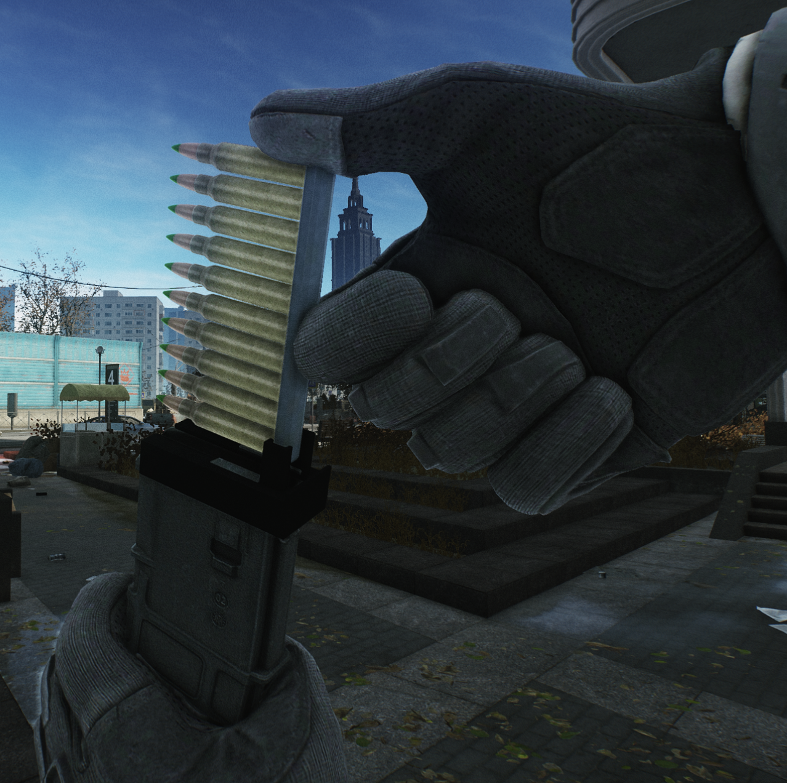
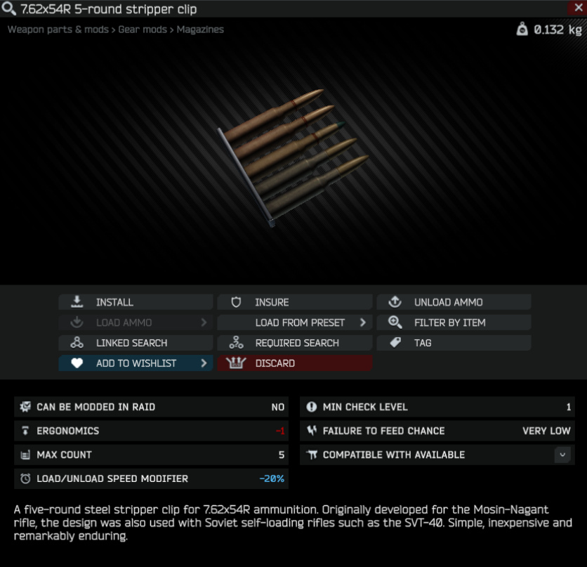

# StripperClips

StripperClips 1.1.0 adds animated stripper-clip reloads to six rifles and animated loading of detached STANAG magazines from 5.56x45 clips, in standalone SPT and Fika multiplayer. Prapor sells the 7.62x54R and 7.62x39 clips and Peacekeeper sells the 5.56x45 clip for $6, all at loyalty level 1.

## Supported rifles

| Ammunition | Clip capacity | Rifles |
|---|---:|---|
| 7.62x54R | 5 rounds | Mosin Infantry, Mosin Sniper, SVT-40, AVT-40 |
| 7.62x39 | 10 rounds | TOZ SKS, OP-SKS |
| 5.56x45 NATO | 10 rounds | Detached STANAG magazines (see below) |

Clip reloads work with the rifles' internal magazines and supported top-loading detachable magazines, including the Mosin ProMag Archangel, SVT-40 and AVT-40 magazines, and the SKS TAPCO 20-round and ProMag AALVX 35-round magazines. The SKS receiver-cover mount, Mosin Kochetov mount, and optics fitted to the OP-SKS dovetail or SKS CHOATE mount block clip reloads.

## Loading STANAG magazines

Drag a loaded 5.56x45 clip onto a compatible magazine in your equipment during a raid. The inventory closes, and the character seats a loading guide on the magazine, inserts the clip and presses the cartridges in, then puts everything away and returns to the previous weapon.

Supported magazines:

- Colt AR-15 STANAG 30-round
- HK Steel Maritime, HK 30 polymer and HK PM Gen.2 STANAG 30-round
- Magpul PMAG 30 GEN M3 and PMAG 30 GEN M3 W, black and FDE
- Magpul PMAG 40 GEN M3, black and FDE
- TROY BattleMag STANAG 30-round
- FN SCAR-L 30-round, black and FDE

Drums, the SureFire MAG5 quad-stack magazines and the 10- and 20-round PMAGs are not supported.

The magazine must be detached and carried in your equipment, and it must have room for the whole clip. Mixed ammunition is supported. Sprinting, reopening the inventory or switching hands interrupts the action; once EFT has confirmed the transfer, the cartridges stay in the magazine.

## Features

- Clips load and unload like magazines. The inventory model and reload animation show the ammunition in the clip.
- A clip reload requires room for every round in the clip, including when the clip is partially filled.
- Native magazine swaps retain priority. With clip preference enabled, a fitting clip takes priority over loading loose rounds. The ammunition selector supports manual clip selection with either setting.
- In Fika raids, host and client clip reloads are visible to other players. Ammunition and chamber changes use Fika's native inventory synchronisation, including mixed-ammunition clips.

## Known limitations

- In Fika raids, STANAG magazine loading is not yet animated for other players. The ammunition transfer itself is synchronised normally.
- The STANAG loading animation still has visual imperfections in first person.

## Screenshots

## Requirements

- SPT 4.1.6 (Escape from Tarkov 0.16.9.40743).
- Fika 2.4.6 for multiplayer. The included Fika adapter loads only when that version of Fika is present.

Bots do not use stripper clips.

## Installation

Close the game and server before installing `StripperClips-1.1.0.zip`.

- **Standalone SPT** — Extract the ZIP into the SPT folder containing `EscapeFromTarkov.exe`.
- **Fika multiplayer** — Copy `BepInEx/plugins/StripperClips` from the ZIP to the host and every client, including a headless raid host if used. Copy `SPT_Runtime/user/mods/StripperClips` to the SPT server. Use the same StripperClips version on all machines. If the server and host share an installation, extract the entire ZIP there.

Multiplayer support activates automatically and needs no configuration. Every player, including the host, must install the same StripperClips version with its Fika adapter. Missing or mismatched installations are unsupported and can disrupt the raid's network traffic.

## Configuration

Use the BepInEx configuration manager (F12) or edit `BepInEx/config/itsripper.stripperclips.cfg`.

| Setting | Default | Description |
|---|---|---|
| PreferClips | true | Prefer stripper clips during reloads. |
| TransitionTrace | false | Enable additional reload diagnostics. |
| StanagTrace | false | Log STANAG magazine-loading phases. |

## Uninstallation

Sell or discard all stripper clips from each profile, including clips in insurance returns and mail. Then delete `BepInEx/plugins/StripperClips` and `SPT_Runtime/user/mods/StripperClips`.

## Building

See [Building StripperClips](docs/BUILDING.md).

## Licence

MIT. See the [third-party notices](THIRD-PARTY-NOTICES.md).
