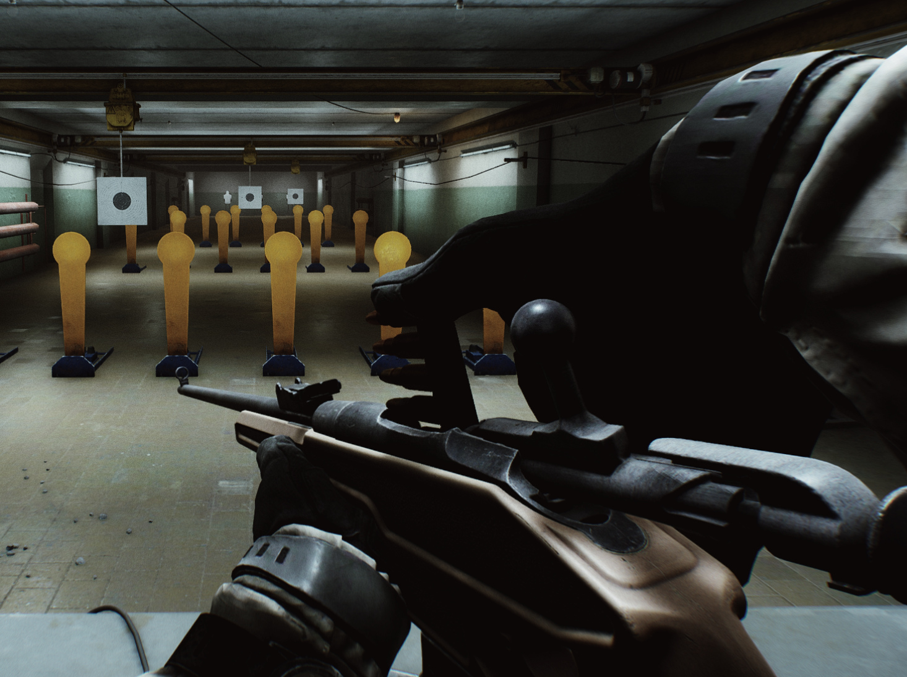
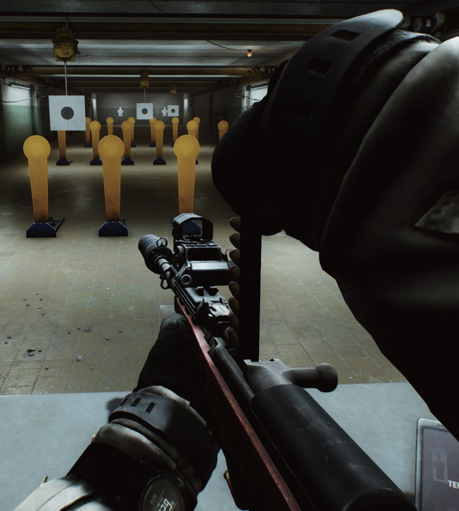

# StripperClips

StripperClips 1.0.0 adds animated stripper-clip reloads to six rifles in SPT. Prapor sells both clip types at loyalty level 1.

## Supported rifles

| Ammunition | Clip capacity | Rifles |
|---|---:|---|
| 7.62x54R | 5 rounds | Mosin Infantry, Mosin Sniper, SVT-40, AVT-40 |
| 7.62x39 | 10 rounds | TOZ SKS, OP-SKS |

Clip reloads work with the rifles' internal magazines and supported top-loading detachable magazines, including the Mosin ProMag Archangel, SVT-40 and AVT-40 magazines, and the SKS TAPCO 20-round and ProMag AALVX 35-round magazines. The SKS receiver-cover mount, Mosin Kochetov mount, and optics fitted to the OP-SKS dovetail or SKS CHOATE mount block clip reloads.

## Features

- Clips load and unload like magazines. The inventory model and reload animation show the ammunition in the clip.
- A clip reload requires room for every round in the clip, including when the clip is partially filled.
- Native magazine swaps retain priority. With clip preference enabled, a fitting clip takes priority over loading loose rounds. The ammunition selector supports manual clip selection with either setting.

## Screenshots

## Requirements

SPT 4.1.6 (Escape from Tarkov 0.16.9.40743). Single player only. Fika and bots are unsupported.

## Installation

Close the game and server, then extract the ZIP into the SPT folder containing `EscapeFromTarkov.exe`.

## Configuration

Use the BepInEx configuration manager (F12) or edit `BepInEx/config/itsripper.stripperclips.cfg`.

| Setting | Default | Description |
|---|---|---|
| PreferClips | true | Prefer stripper clips during reloads. |
| TransitionTrace | false | Enable additional reload diagnostics. |

## Uninstallation

Sell or discard all stripper clips from each profile, including clips in insurance returns and mail. Then delete `BepInEx/plugins/StripperClips` and `SPT_Runtime/user/mods/StripperClips`.

## Building

See [Building StripperClips](docs/BUILDING.md).

## Licence

MIT. See the [third-party notices](THIRD-PARTY-NOTICES.md).
